# Prativimb

**A patient twin that answers what if, not just what next.**

My submission for the Happiest Health hackathon, Digital Twin track, Phase 1 (prototype and code). Every patient in this repository is synthetic and fictional. Prativimb is decision support only, not a diagnosis.

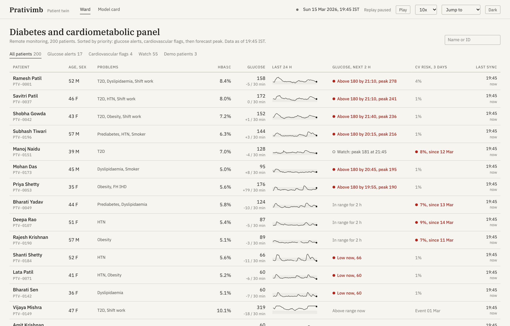

## 1. Team details

**Team name:** pushkalayeddula

**College:** Anurag University, Hyderabad, Telangana

**Incubator:** none

I'm Pushkala Yeddula ([@ypushkala](https://github.com/ypushkala)), and I built Prativimb on my own. That covers the research, the synthetic patient data, the digital twin and the models, the dashboard, the tests, the slides and the demo video.

| Member | Role |
|---|---|
| Pushkala Yeddula | Solo developer: idea, data, models, dashboard, testing and documentation |

## 2. Project title

**Prativimb** (Sanskrit for *reflection*): a hybrid digital twin for Type 2 diabetes and cardiovascular risk, built for Indian patients.

## 3. Problem statement

India has about 101 million adults with diabetes and 136 million with prediabetes (ICMR-INDIAB, Lancet Diabetes & Endocrinology, 2023). Most of them see a doctor every three months, but their glucose, sleep and heart rhythm change every five minutes. CGMs and smartwatches already record all of this, yet they only show what has already happened. Risk scores tell you who is at risk, but not what to change today, why, or how sure they are.

I wanted a model of each patient that can:

1. warn about a problem early enough to act on it,
2. explain itself in words a clinician uses,
3. be honest about how uncertain it is, and
4. answer "what if": what if he walks after dinner, eats millets instead of white rice, misses a dose, sleeps more, or works a night shift?

## 4. Healthcare use case

The setting is a diabetes and heart clinic that follows its patients remotely between visits.

**The two events I predict**

* **High glucose, two hours ahead.** Prativimb forecasts when glucose will go above 180 mg/dL, using the CGM, steps, heart rate, sleep, meal logs and the health record. A possible high stays on the patient's page; a confident one is pushed to the ward list. Lows are flagged too, with a separate model, and an overnight low caused by pressure on the sensor is reported as probably the sensor rather than as a real low.
* **Raised heart risk, three days ahead.** From a rolling week of resting heart rate, heart rate variability, sleep and steps, together with blood pressure, cholesterol and family history, it estimates the chance of a heart event in the next three days and shows which signs are pushing it up.

**What a clinician can do with it**

* **See who needs attention and why.** The ward groups patients by urgency (lows first, then likely highs, then heart risk) and gives a few words on why each alert fired. The first button fits the alert: check the patient now, call them, book a review, or try a change.
* **Try a change.** Re-run tonight, the next 24 hours or the next 7 days with a walk, a food swap, a different meal time, more sleep, a missed dose, a night shift, or (for discussion only) insulin. The best changes for that patient are shown first.
* **Check the answer.** Because my patients come from a richer simulator than the twin, I can re-run that simulator with the same change and see whether the twin was right. For Ramesh tonight, the twin says a walk and millets lower his peak by 57 mg/dL, and the reference simulator says 61.
* **Know what would make the forecast sharper.** For example: "Logging dinner would narrow the 21:45 range from 204 to 334 down to about 231 to 324."
* **See inside the twin.** An animation of food moving from the stomach to the gut to the blood, insulin acting, and a walk pulling glucose into the muscles, with the usual plan and the change side by side.
* **Ask in plain words.** Typing "What if he skips rice and walks after dinner for the next week?" sets up the simulation, and you can check the settings before trusting the result.
* **Reach the patient.** Send a suggestion to the patient's phone in Hindi, Tamil or English, with a Listen button that reads it aloud. When the patient replies "I will walk after dinner", the forecast updates, and later both sides see how the evening actually went.
* **Plan ahead.** A festival planner shows who is likely to run high on Ugadi, Gudi Padwa, the Navratri fast or Eid, what would help each person most, and lets you message them before the day. A ward-level what if adds up what a change would do across everyone at risk tonight.
* **Follow up.** For every alert in the past week you can see what the forecast said, whether it came true, how much warning it gave, and what the team did. A doctor can agree a 7 day plan with a patient, and a week later the dashboard checks whether the plan was followed and whether it helped.
* **Keep the twin honest.** It tracks each twin's recent error, flags it when the fit drifts, and tests whether a refit would actually help before anyone refits.
* **Hand over the shift.** One page lists what is still open, what was done and by whom. A morning digest summarises the day before.

**People and consent**

Doctors, nurses or health educators, and patients each sign in with different permissions, and the service checks them on every change. Patients can log their own meals, and they can stop or restart sharing their glucose, wearable data or health records from their own page. The service stops using any source they withdraw.

**The three demo patients**

| Patient | Story | What Prativimb shows |
|---|---|---|
| Ramesh Patil, 52, Mumbai | Type 2 diabetes, night shift security supervisor, sleeping 4.9 hours | At 19:45 a confident alert: a peak of about 278 mg/dL near 21:45 after his usual dinner. A 15 minute walk and millets instead of rice cut the peak by 57 mg/dL. An earlier dinner barely helps tonight, and the twin says so. |
| Fatima Shaikh, 46, Hyderabad | Prediabetes, observing Ramadan | At 18:00 a low before iftar, then a confident rebound alert to about 206 mg/dL after iftar. The low was forecast from 16:00. |
| Suresh Menon, 61, Kochi | High blood pressure; his father had a heart attack at 58 | Falling heart rate variability, a rising resting heart rate and lighter sleep raise his heart risk flag on 9 March, four days before a simulated event on 13 March. |

| Patient, Today | Try a change |
|---|---|
| 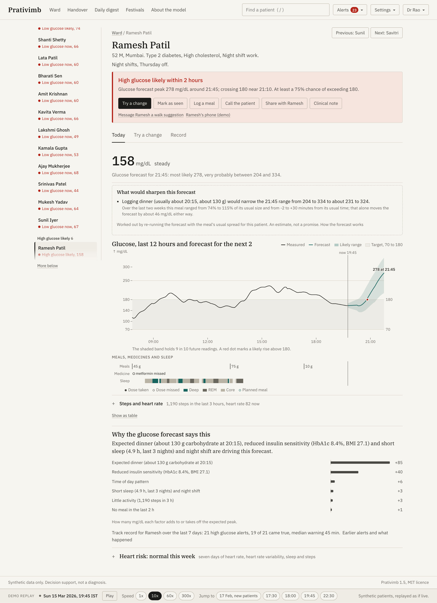 | 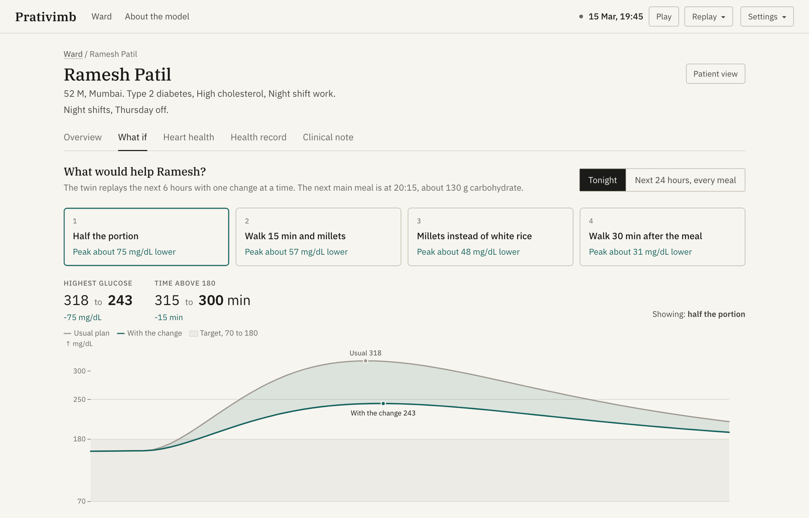 |
| **Low glucose, then a rebound around iftar** | **Heart risk week** |
| 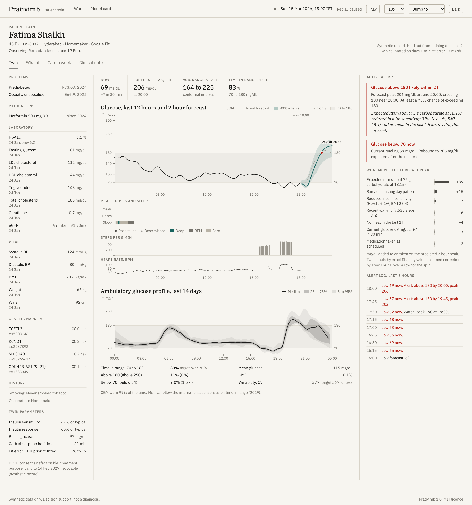 | 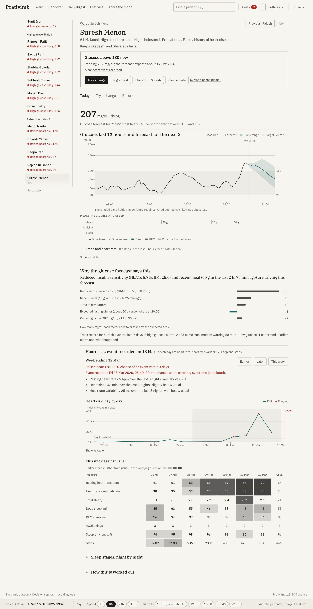 |

| **Checked against the reference simulator** | **The patient's phone, after the walk** |
|---|---|
| 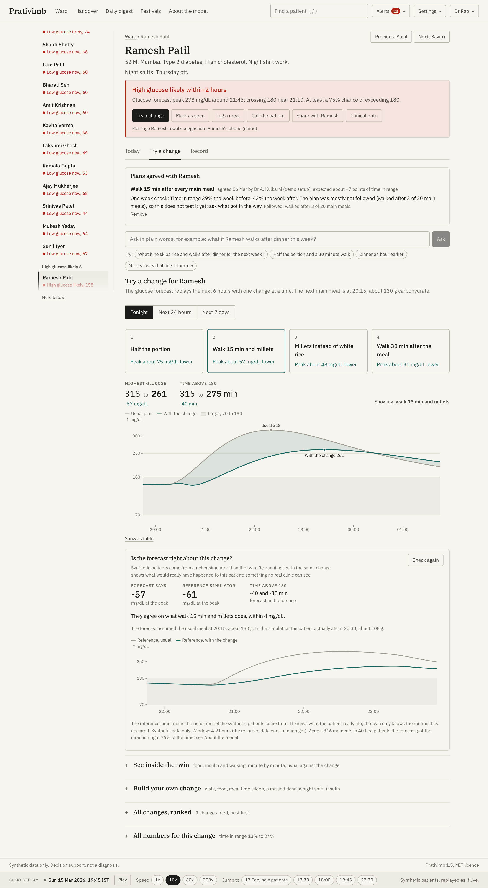 | 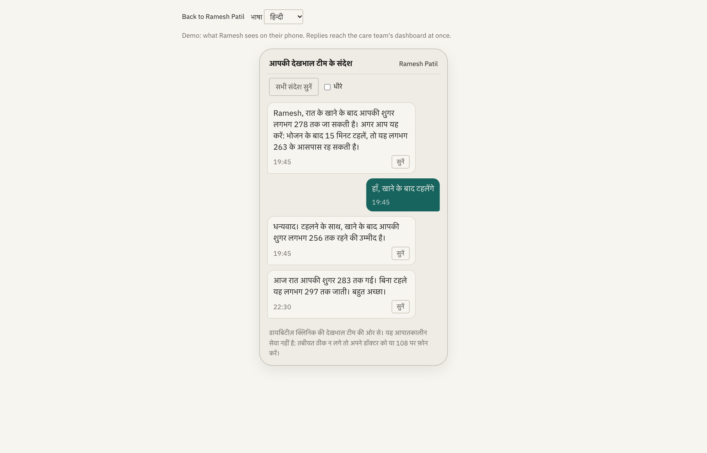 |
| **Earlier alerts and what happened** | **A plan and its one week check** |
| 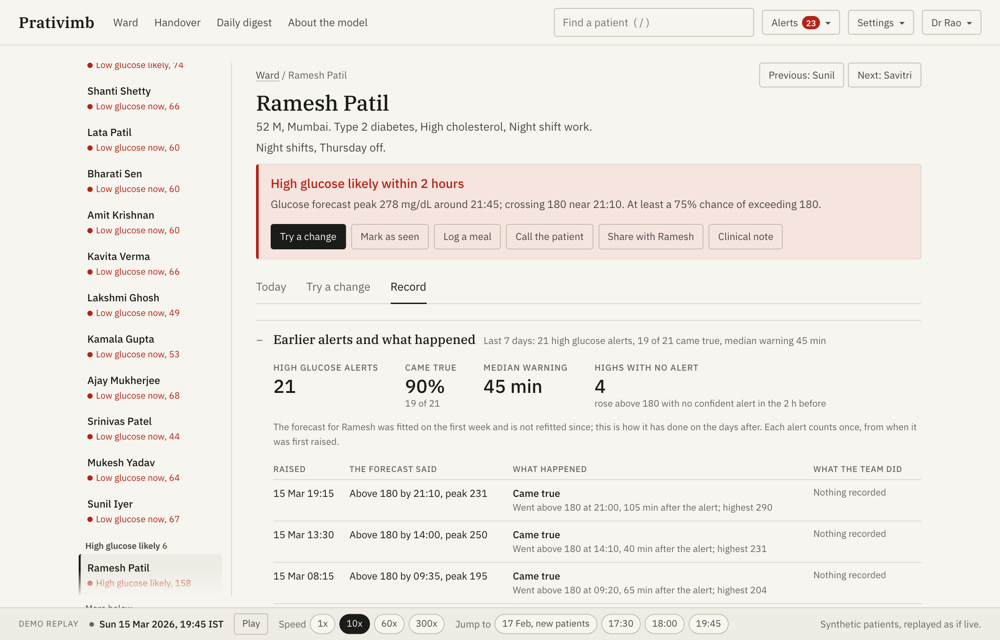 | 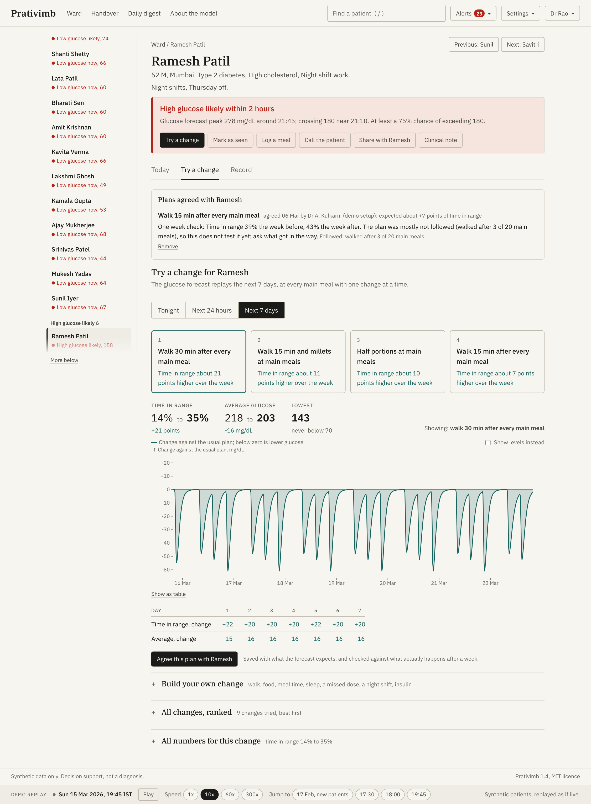 |

You can find more screens (clinical note, festival planner, handover, daily digest, a new patient's first week, the Hindi patient view, phone layout, dark mode) in [`docs/screenshots/`](docs/screenshots/).

**How to use it.** Sign in as a doctor, a nurse or a patient (the demo has no passwords). The ward opens on the patients who need attention. Press `n` to jump to the next alert nobody has seen yet, or `/` to find any patient. Each patient has three tabs: **Today** (the forecast and why), **Try a change** and **Record** (past alerts, the two week pattern, the health record and consent). The strip at the bottom controls the demo clock: play, change speed, or jump to 17:30, 18:00, 19:45 or 22:30, or to 17 Feb to see brand new patients.

## 5. Technical stack

| Layer | Tools |
|---|---|
| Language and runtime | Python 3.11, TypeScript 5 |
| Physiology and optimisation | NumPy, SciPy (`solve_ivp`, `least_squares`) |
| Machine learning | LightGBM, scikit-learn (isolation forest, logistic regression), SHAP |
| Uncertainty | Conformalised quantile regression (`prativimb/ml/conformal.py`) |
| Data | pandas, PyArrow (Parquet), DuckDB, FHIR R4 shaped JSON |
| Synthetic data | My own Synthea style health record generator, and the UVA/Padova glucose model with simglucose parameters and CGM noise |
| API | FastAPI, Pydantic, Uvicorn, WebSockets for the live replay, ReportLab for the PDF note |
| Dashboard | React 18, Vite 5, Observable Plot, IBM Plex and Noto Sans (Devanagari, Tamil), Web Speech API for Listen |
| Documents | Matplotlib, python-pptx, Playwright for screenshots |
| Quality | pytest (49 tests), axe-core accessibility audit (WCAG 2.1 AA, clean on every screen in light and dark) |
| Deployment | Docker Compose, or a Makefile without Docker |

## 6. AI/ML model and framework details

1. **The twin itself (physics).** Each patient gets an extended Bergman minimal model. It tracks seven things over time: glucose, insulin, insulin action, food in the stomach and gut, exercise, and metformin. It also accounts for time of day, sleep debt, night shifts, the dawn effect and how fast each food is absorbed. Eight personal parameters start from the health record (HbA1c, BMI, fasting glucose, TCF7L2 genotype, age) and are then fitted to the patient's first week of CGM, meals, steps and doses, which takes about one second per patient.
2. **Learning the twin's mistakes.** A LightGBM model for each horizon (30, 60, 90 and 120 minutes) learns where the twin tends to be wrong, using recent glucose, meals, activity, sleep, missed doses and the health record. The hybrid beats both the physics alone and machine learning alone.
3. **Honest uncertainty.** Conformalised quantile regression gives a 90% range around every forecast. An alert is pushed only when even the low end of a tighter range crosses 180, which means at least a 75% chance of going high.
4. **Heart risk.** Personal baselines, an isolation forest and a LightGBM classifier are combined by logistic regression, with the threshold set at 95% specificity.
5. **Low glucose.** A separate LightGBM classifier predicts glucose below 70 mg/dL within an hour. It is trained on labels cleaned of sensor pressure artefacts.
6. **Explanations.** Exact Shapley values on the twin's inputs and TreeSHAP on the learned part show how many mg/dL each factor adds. These are turned into one plain sentence, for example: *"Expected dinner (about 130 g carbohydrate at 20:15), reduced insulin sensitivity and short sleep are driving this forecast."*
7. **Checking what ifs.** The simulator that generated the patients can restart from any moment, so every what if can be re-run in a richer model the twin never sees (`prativimb/data/reference.py`).
8. **Plain words to settings.** A phrase matcher (`prativimb/api/ask.py`) turns a question into simulation settings without any internet connection. If an API key is set, an optional language model fills in the same settings instead. It never produces the numbers.

More detail is in the model card: [`docs/MODEL_CARD.md`](docs/MODEL_CARD.md).

## 7. Demo video

**Watch the demo:** link coming soon. The video will be an unlisted YouTube video of about 20 minutes, and I will add its link here.

<!-- Replace the line above with: **Watch the demo:** https://youtu.be/... (unlisted, about 20 minutes) -->

## 8. Architecture diagram

PDF: [`docs/architecture.pdf`](docs/architecture.pdf)

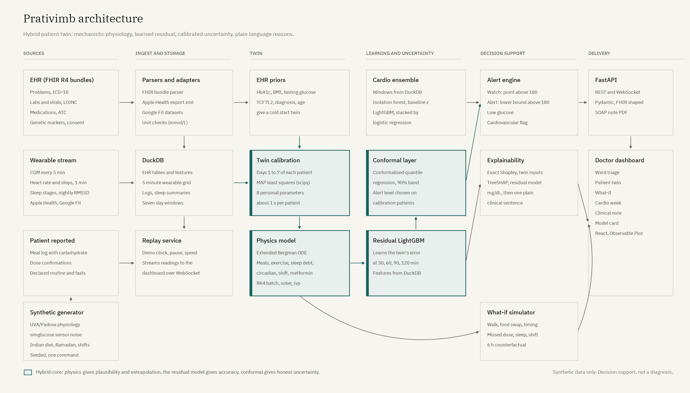

## 9. Presentation

* PowerPoint: [`docs/presentation.pptx`](docs/presentation.pptx)
* PDF: [`docs/presentation.pdf`](docs/presentation.pdf)

## 10. Results and metrics summary

All results are on **40 test patients** that were never used for training or tuning, on days 8 to 30 (days 1 to 7 are used to fit each twin). The full report is in [`reports/metrics.md`](reports/metrics.md).

| Glucose forecast error, RMSE (mg/dL) | 30 min | 60 min | 120 min |
|---|---:|---:|---:|
| Twin from the health record only | 25.8 | 33.4 | 35.2 |
| Twin after fitting (physics only) | 16.7 | 24.8 | 29.0 |
| LightGBM only | 13.7 | 21.6 | 27.6 |
| **Hybrid twin** | **12.9** | **20.2** | **25.2** |

| Metric | Value |
|---|---|
| MARD, hybrid, 30 / 60 / 120 min | 7.4% / 11.1% / 13.7% |
| Clarke zone A, 30 / 60 / 120 min | 94.2% / 85.4% / 79.3% |
| 90% range coverage, 30 to 120 min | 89.8% / 89.2% / 88.7% / 88.7% |
| Confident high alerts: sensitivity, precision | 67.1%, 85.2% |
| Confident high alerts: median warning, false alarms per patient per day | 30 min, 0.20 |
| Possible highs: sensitivity, median warning, false alarms per patient per day | 90.3%, 75 min, 0.65 |
| Heart risk AUROC (95% CI) | 0.95 (0.90 to 0.99) |
| Heart events flagged in the 3 days before | 5 of 6 (median 3 days ahead, 94% specificity) |
| Lows flagged in advance | 37%, with 61% precision |

**Alert load.** Per patient per day there are 1.33 confident high alerts (94% came true), 1.89 possible highs and 1.06 low glucose alerts. On a ward of 200 patients like these, about 25 would need attention at a typical moment. Details: [`reports/followup.md`](reports/followup.md).

**Are the what if answers right?** I tested 316 moments in 40 test patients, 40 minutes before a real meal, with 8 changes each, against the reference simulator. The twin got the direction of the effect right 76% of the time, with a typical error of 9 mg/dL. The change that really helped most was among the twin's top two picks 85% of the time. Its weak spot is moving a meal earlier, which it does not penalise enough. Details: [`reports/counterfactual.md`](reports/counterfactual.md).

**How far to trust the heart risk flag.** The heart events and their warning signs come from my own simulator, the same one the model learned from, so the 0.95 AUROC mostly shows that it learned my simulator. When I weakened the warning signs to half strength it still caught 4 of 6 events; at a quarter strength it caught 1 of 6. So it shows the pipeline works, not that it predicts real heart events.

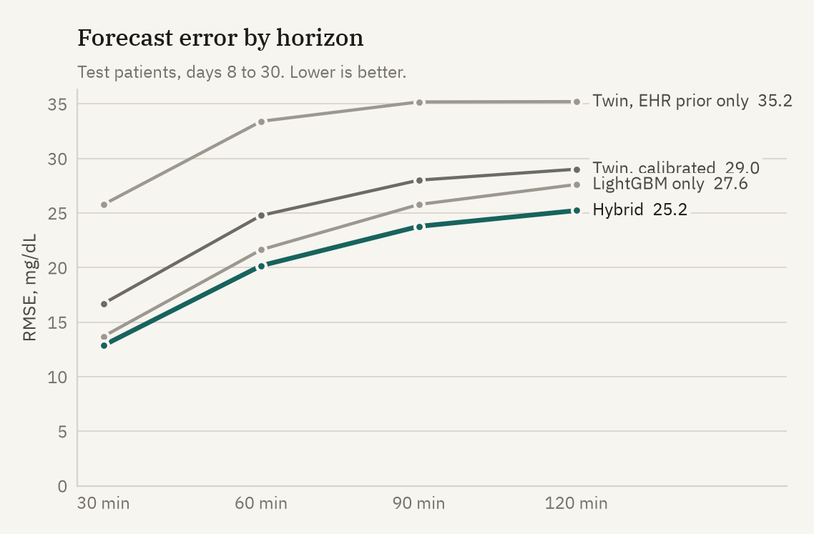

### Real CGM data

I also tested on **CGMacros** (PhysioNet, open access, CC BY-NC-SA 4.0): 45 adults in the US, with Dexcom G6 sensors and meals with known carbohydrate. The models trained only on my synthetic data were applied unchanged. Full results: [`reports/real_data.md`](reports/real_data.md).

| Error on real data, RMSE (mg/dL) | 30 min | 60 min | 120 min |
|---|---:|---:|---:|
| Persistence (glucose stays where it is) | 19.7 | 28.6 | 38.3 |
| Hybrid, trained on synthetic data only | 19.3 | 29.5 | 36.7 |
| **Twin, told about meals in advance** | 20.7 | **26.1** | **29.6** |

Training only on synthetic data gets about as far as persistence on real people. Once the twin knows the meal, though, it cuts the two hour error by 23%, which is exactly what the meal logging in the dashboard is for.

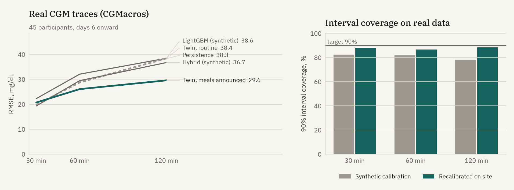

## 11. Quick start

You need Python 3.11 and Node 20 or newer, or Docker. The data and models are regenerated from a fixed seed, so nothing large is committed.

### With Docker

```bash
docker compose up --build
# dashboard: http://localhost:8080   API: http://localhost:8000/docs
```

The first build takes about 20 to 25 minutes, because it generates the data and trains every model. After that the container starts in seconds.

### Without Docker

```bash
make setup     # Python environment, npm packages, Playwright
make all       # synthetic data, twin fitting, models and reports (about 5 minutes)
make api       # terminal 1: API on http://127.0.0.1:8000
make web       # terminal 2: dashboard on http://localhost:5173
```

Or run `make serve` to build the dashboard and serve everything from port 8000.

### Other commands

```bash
make data          # synthetic health records and wearables only (about 20 s)
make train         # twins, models and reports
make test          # pytest suite
make docs          # architecture diagram and slides
make screenshots   # needs make api and make web running
make a11y          # accessibility audit of every screen (needs make serve)
make realdata      # download CGMacros from PhysioNet and test on real data
```

The demo clock starts on Sunday 15 March 2026 at 19:45 IST. Set `PRATIVIMB_PAUSED=1` or `PRATIVIMB_SPEED=60` before `make api` to change how it starts.

### Repository layout

```
prativimb/data      synthetic patients, physiology, sensors, FHIR, device adapters, reference simulator
prativimb/twin      the Bergman model, fitting, forecasting and what ifs
prativimb/ml        features, residual models, conformal ranges, heart risk, explanations
prativimb/eval      metrics, alert checks, what if checks, reports and figures
prativimb/api       FastAPI app, replay clock, services, PDF note
frontend/           React dashboard and the patient's phone view
docs/               architecture, slides, model card, data notes, screenshots
reports/            metrics, follow up and what if reports, figures
tests/              pytest suite
```

## 12. Data sources and privacy

* **Synthetic only.** The 200 fictional patients come from my own Synthea style generator (FHIR R4 bundles) and the UVA/Padova glucose model with simglucose parameters (MIT). I did not use any dataset that needs a data use agreement, or any real person's data. Every source and licence is listed in [`docs/DATA.md`](docs/DATA.md).
* **DPDP Act 2023 and HIPAA.** No personal data is processed, so neither applies to this prototype, but I designed it as if they did. Consent can be withdrawn on screen, no identifiers go into the models, every action is written to an audit log, and the design assumes everything runs inside the hospital network.
* **Reproducible.** Seed 20260315; one command regenerates every file.
* **Real data for validation only.** CGMacros (Gutierrez-Osuna, Kerr, Mortazavi and Das, PhysioNet 2025, doi:10.13026/3z8q-x658) is open access under CC BY-NC-SA 4.0. It is downloaded by `scripts/fetch_cgmacros.sh`, used only for non commercial evaluation and never redistributed. Only the derived metrics are committed.

## 13. Open-source licence details

Prativimb is released under the **MIT licence** ([`LICENSE`](LICENSE)).

Third party components and their licences:

| Component | Licence |
|---|---|
| NumPy, pandas, SciPy, scikit-learn, joblib, Uvicorn, httpx, ReportLab | BSD |
| LightGBM, SHAP, DuckDB, FastAPI, Pydantic, simglucose (and its gym dependency), python-pptx, pytest | MIT |
| PyArrow, Playwright, TypeScript | Apache 2.0 |
| Matplotlib | Matplotlib licence (PSF based) |
| React, React Router, Vite, Fontsource packages | MIT |
| Observable Plot | ISC |
| IBM Plex Serif and Sans (in `assets/fonts`), Noto Sans Devanagari and Tamil | SIL Open Font License 1.1 |
| axe-core (accessibility audit, development only) | MPL 2.0 |
| CGMacros dataset (validation only, not redistributed) | CC BY-NC-SA 4.0 |
| UVA/Padova model equations (Dalla Man et al. 2007) | Published research, implemented independently |

## 14. Future work

* Test Prativimb on real, de-identified patient data, including real heart events.
* Connect to real CGM and smartwatch apps (FreeStyle Libre, Dexcom, Health Connect, Apple Health).
* Link to ABDM so patients can share their health records with real consent.
* Let each twin keep learning as new weeks of data arrive.
* Run a small pilot in a clinic.
