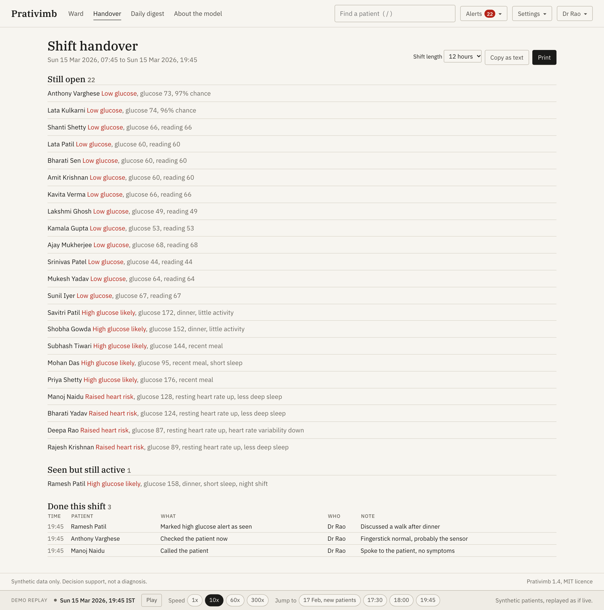
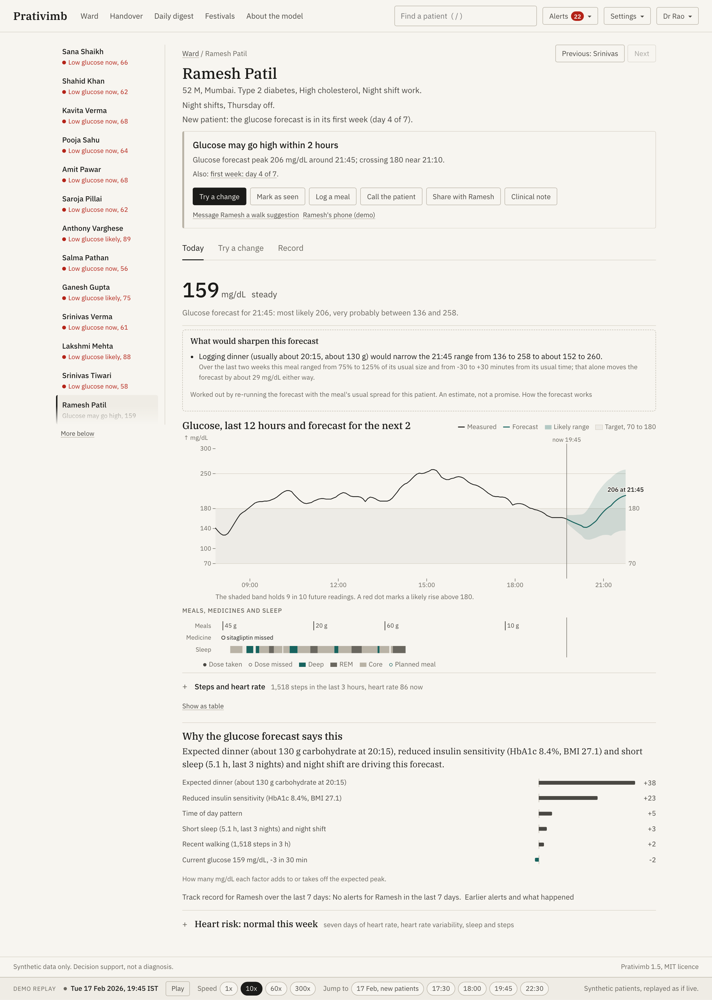

# Prativimb

**A patient twin that answers what if, not just what next.**

Happiest Health hackathon, Digital Twin track, Phase 1: prototype and code submission. All patient data in this repository is synthetic and fictional. Decision support only, not a diagnosis.


## 1. Team details

| Name | Role | Email |
|---|---|---|
| `<Member 1>` | `<Role, for example lead and modelling>` | `<email>` |
| `<Member 2>` | `<Role>` | `<email>` |
| `<Member 3>` | `<Role>` | `<email>` |
| `<Member 4>` | `<Role>` | `<email>` |

**College / Incubator:** `<CollegeName>`, `<City>` / `<Incubator name, if any>`

**Team name:** `<TeamName>` (repository folder: `<TeamName>_<CollegeName>`)

## 2. Project title

**Prativimb** (Sanskrit for *reflection*): a hybrid digital twin for Type 2 diabetes and cardiovascular risk, built for Indian patients.

## 3. Problem statement

India has about 101 million adults with diabetes and 136 million with prediabetes (ICMR-INDIAB, Lancet Diabetes & Endocrinology, 2023). Most are reviewed every three months, while glucose, sleep and heart rhythm change every five minutes. CGMs and smartwatches now record that stream, but they show what already happened. Risk scores say who is at risk; they do not say what to change today, why, or how sure they are.

We need a model of each patient that (a) forecasts adverse events early enough to act, (b) explains itself in clinical language, (c) states its uncertainty honestly, and (d) can be asked "what if": what if he walks after dinner, eats millets instead of white rice, misses a dose, sleeps more, works a night shift?

## 4. Healthcare use case

A diabetes and cardiometabolic clinic monitors patients remotely between visits.

* **Event A, glucose spike forecast.** Two hours ahead, flag glucose above 180 mg/dL from CGM, steps, heart rate, sleep, meal logs and the EHR. Two tiers: *watch* (point forecast crosses 180; shown, not pushed) and *alert* (the conformal lower bound crosses 180; pushed to the ward list). Lows are flagged too.
* **Event B, cardiovascular risk flag.** From a rolling seven day window of resting heart rate, HRV (RMSSD), sleep architecture and activity, conditioned on hypertension, lipids and family history, estimate the risk of an event in the next three days, with a weekly trajectory and the top contributing factors.
* **Try a change.** Re-simulate tonight, the next 24 hours or the next 7 days under a walk, a food swap, a meal time shift, a missed metformin dose, different sleep, a night shift, moving the evening metformin, or (simulated with typical insulin action) mealtime or long acting insulin. A day or a week ahead the chart shows the change against the usual plan, because the absolute level drifts.
* **Plans and the one week check.** A doctor can agree a 7 day plan with the patient. A week later the dashboard compares time in range before and after with what the forecast expected, and checks from the data whether the plan was followed (walks after meals from steps, food swaps from the meal log, sleep from the wearable).
* **Record.** One click SOAP note (printable page and PDF) of the twin's findings.
* **Low glucose.** A dedicated model for glucose below 70 mg/dL within 60 minutes, with overnight sensor compression artefacts recognised and reported as such instead of as lows.
* **Working the list.** The ward groups patients by urgency (lows, likely highs, raised heart risk) and says in a few words why each alert fired. The first action fits the alert: check the patient now for a low, call the patient or book a review for heart risk, try a change for a likely high. Clinicians mark alerts as seen (choosing which ones), record calls and checks, log planned or eaten meals, and can undo any of it for 10 seconds. A shift handover page lists what was done, by whom, and what is still open; a daily digest summarises the day before for email; new confirmed alerts can raise a desktop notification.
* **Checked against the reference.** The synthetic patients come from a richer, deterministic simulator than the twin, so any what if can be re-run in that simulator with the change applied to what the patient really ate: "the twin says a walk and millets lower Ramesh's peak by 57; the reference simulator says 61". Across 316 moments in 40 test patients the twin gets the direction right 76% of the time ([`reports/counterfactual.md`](reports/counterfactual.md)). No real clinic can see this; it is the one thing synthetic data allows that real data does not.
* **What would sharpen the forecast.** When the range is wide, the dashboard says which missing information would narrow it most: "logging dinner (usually 20:15, about 130 g) would narrow the 21:45 range from 204 to 334 to about 231 to 324", or a fingerstick to settle a suspicious low.
* **Inside the twin.** An animated view of the twin's own states, usual plan against the change: food in the stomach and gut, glucose entering the blood, insulin action and a walk pulling it into muscle.
* **Ask in plain words.** "What if he skips rice and walks after dinner for the next week?" becomes the simulator's settings, shown for checking. A built in phrase matcher does this offline; if an API key is set, a language model may fill the same settings (only the question is sent). The numbers always come from the twin.
* **The loop with the patient.** The care team messages a suggestion to the patient's phone in Hindi, Tamil or English (with a Listen button); the patient replies; a walk the patient promises enters the forecast, and the replay follows the reference simulator from then on, so the evening's result ("283 tonight; about 297 without the walk") reaches both the patient and the dashboard.
* **Festival planner.** Each patient's twin replays the coming festival day against a usual day, and again with each suggestion: Gudi Padwa (puran poli) in Maharashtra, Ugadi (obbattu or bobbatlu) in Karnataka, Telangana and Andhra Pradesh, the first Navratri fast, Eid al-Fitr (date depends on the moon). For each patient: how much longer above 180, what helps most (half the sweet, a walk after the festive meal, or a smaller fast meal) and how much it saves. Message one patient or all of them before the day, in their language; copy the call list; each patient's Today shows what is coming up.
* **Ward what if.** Every change across tonight's likely high patients at once, added up, against each patient's own best change (tonight: 4.0 fewer hours above 180 if each does what helps them, 2.9 if everyone takes a 30 minute walk). One button messages each patient their own best change.
* **Twin health.** Each twin's recent 2 hour error against its first week of use, week by week, flagged on the ward when it drifts. Before refitting, *Would a refit help?* refits on the week that ended three days ago and tests old and new on the days since; a refit is not always the fix (for a drifting patient here it changes nothing, because the drift came and went), and the screen says so.
* **Listening.** Every message and the patient page can be read aloud with the device's own voices (nothing leaves the device), sentence by sentence, slower if wanted, with units spoken in words. If the device has no Hindi or Tamil voice it says so and offers the English version.
* **Follow up.** Every patient has *Earlier alerts and what happened*: each alert in the last 7 days, what the forecast said, whether it came true, how much warning it gave, what the team did, and how many highs came with no alert.
* **New patients.** In a patient's first week the forecast runs on values from the health record, says so, and does not push possible highs to the ward.
* **Patients, roles and consent.** Doctors, nurses or health educators, and patients sign in to different permissions, checked by the service. Patients log meals and withdraw or grant sharing of glucose, wearable data and ABDM records from their own page, and the service stops using a withdrawn source.

Three fictional demo patients carry the story:

| Patient | Story | What the twin shows |
|---|---|---|
| Ramesh Patil, 52, Mumbai | T2D, night shift security supervisor, 4.9 h sleep | At 19:45 a confident alert: peak about 278 mg/dL near 21:45 after his usual dinner. A 15 minute walk and millets instead of rice cut the simulated peak by 57 mg/dL and time above 180 by 40 minutes. An earlier dinner barely helps tonight, and the twin says so. |
| Fatima Shaikh, 46, Hyderabad | Prediabetes, observing Ramadan | At 18:00 a low before iftar and a confident rebound alert to about 206 mg/dL after iftar; the low was forecast from 16:00. |
| Suresh Menon, 61, Kochi | Hypertension, father had an MI at 58 | Falling HRV, rising resting heart rate and lighter sleep raise the cardiovascular flag on 9 March, four days before a simulated event on 13 March. |

| Patient, Today | Try a change |
|---|---|
|  |  |
| **Low glucose to rebound around iftar** | **Heart risk week** |
|  |  |

| **Earlier alerts and what happened** | **A plan and its one week check** |
|---|---|
|  |  |
| **Checked against the reference simulator** | **The patient's phone, after the walk** |
|---|---|
|  |  |
| **Shift handover** | **A new patient's first week** |
|  |  |

More screens (clinical note, model card, daily digest, sign in, patient view in Hindi, phone layout, dark mode) are in [`docs/screenshots/`](docs/screenshots/).

**Using it.** Sign in as a doctor, a nurse or health educator, or a patient (no password in the demo). The ward opens on the patients who need attention, grouped by urgency, with a line comparing the count to a typical day at that hour and one line on what changed since your last visit; `j` and `k` move, `Enter` opens, and `n` anywhere opens the next alert nobody has seen. Find any patient from the top bar with `/` or `Ctrl K`. On a patient, a slim list of everyone needing attention stays on the left, **Previous** and **Next** (or `Alt` and the arrow keys) step through it, and the ward keeps its scroll position when you go back. Under the name, one banner gives the most important alert with actions that fit it, plus **Share with** the patient and **Clinical note** (a printable sheet). Three tabs are named after tasks: **Today** (glucose, the forecast, why it says this, its track record for this patient, and a heart risk line that opens into the week), **Try a change** (agreed plans, then the changes that help most tonight, over a day or over a week) and **Record** (earlier alerts and what happened, the two week pattern, care team actions, the health record, and data and consent). **Settings** switch glucose units (mg/dL or mmol/L), India or local time, larger text, tips and desktop notifications. **Festivals** in the top bar lists whom to call before the next festivals. Demo controls (play, speed, jump to 17 Feb for new patients, 17:30, 18:00, 19:45, 22:30) sit in a separate strip at the bottom; *Ramesh's phone (demo)* in his banner opens what he sees. Every chart has a *Show as table* option.

## 5. Technical stack

| Layer | Tools |
|---|---|
| Language and runtime | Python 3.11, TypeScript 5 |
| Physiology and optimisation | NumPy, SciPy (`solve_ivp`, `least_squares`) |
| Machine learning | LightGBM, scikit-learn (isolation forest, logistic regression), SHAP |
| Uncertainty | Conformalised quantile regression, implemented in `prativimb/ml/conformal.py` |
| Data | pandas, PyArrow (Parquet), DuckDB, FHIR R4 shaped JSON |
| Synthetic data | Own Synthea style EHR generator, UVA/Padova model with simglucose parameters and CGM noise |
| API | FastAPI, Pydantic (FHIR shaped schemas), Uvicorn, WebSocket replay, ReportLab (PDF) |
| Dashboard | React 18, Vite 5, Observable Plot, IBM Plex Serif and Sans, Noto Sans Devanagari and Tamil, Web Speech API (Listen) |
| Docs | Matplotlib (charts and architecture as code), python-pptx, Playwright (screenshots) |
| Quality | pytest (49 tests), style check for dashes and emoji, axe-core accessibility audit (WCAG 2.1 AA, clean on every screen in both themes) |
| Deployment | Docker Compose, or a Makefile without Docker |

## 6. AI/ML model and framework details

1. **Hybrid twin (physics).** An extended Bergman minimal model per patient, with seven states (glucose, remote insulin action, insulin, stomach and gut carbohydrate, exercise, metformin level) and known modifiers (circadian insulin sensitivity, three night sleep debt, night shift misalignment, dawn effect, metformin regularity, food specific absorption speed). Eight personal parameters start from an **EHR prior** (HbA1c, BMI, fasting glucose, TCF7L2 genotype, diagnosis, age) and are refined by **maximum a posteriori least squares** on the first week of CGM, meals, steps and doses (about one second per patient). A CGM observer initialises each forecast. Batch forecasts use a vectorised RK4 integrator; what-if scenarios use `scipy.integrate.solve_ivp`; a test checks they agree within 1 mg/dL.
2. **Residual LightGBM (data).** One model per horizon (30, 60, 90, 120 min) learns the twin's error from CGM history and trend, logged and expected meals, steps and heart rate, completed sleep, adherence, EHR covariates and twin parameters. Ablations: physics only, ML only (no twin features), hybrid.
3. **Conformal layer.** Conformalised quantile regression (Romano et al. 2019) with quantile LightGBMs, calibrated on 40 held out patients: 90% intervals for display; the alert uses the lower bound of the 50% interval ("at least a 75% chance of exceeding 180"), a level chosen on calibration patients as the most sensitive with at most 0.10 false alarms per patient day.
4. **Cardiovascular anomaly ensemble.** Per patient baseline z scores and an isolation forest (unsupervised) plus a LightGBM classifier trained on synthetic labelled episodes, stacked by logistic regression on calibration patients; threshold at 95% specificity.
5. **Low glucose model.** A LightGBM classifier for glucose below 70 mg/dL within 60 minutes, trained on labels cleaned by a compression artefact filter (fast, symmetric overnight dips), with its threshold chosen on calibration patients.
6. **Reference check of what ifs.** The data generator's UVA/Padova physiology restarts from saved state, so every what if can be re-run in a richer model the twin never sees (`prativimb/data/reference.py`, `prativimb/eval/counterfactual.py`).
7. **Plain words to settings.** A phrase matcher (`prativimb/api/ask.py`) turns a question into what if settings offline; an optional language model (claude-haiku-5-5, only if an API key is set) fills the same settings and never produces numbers.
8. **Explainability.** Exact Shapley values over six twin inputs (64 batched simulations) plus TreeSHAP of the residual model, in mg/dL of predicted peak, turned into one sentence such as *"Expected dinner (about 130 g carbohydrate at 20:15), reduced insulin sensitivity (HbA1c 8.4%, BMI 27.1) and short sleep (4.9 h, last 3 nights) and night shift are driving this forecast."* Cardiovascular factors are worded against the patient's own baseline.

Details: [`docs/MODEL_CARD.md`](docs/MODEL_CARD.md).

## 7. Demo video

**Unlisted YouTube link:** `<https://youtu.be/...>` (about 20 minutes).

The timed script is in [`docs/VIDEO_SCRIPT.md`](docs/VIDEO_SCRIPT.md).

## 8. Architecture diagram

PDF: [`docs/architecture.pdf`](docs/architecture.pdf). Generated from code by `scripts/make_architecture.py`.


## 9. Presentation

* PowerPoint: [`docs/presentation.pptx`](docs/presentation.pptx)
* PDF: [`docs/presentation.pdf`](docs/presentation.pdf)

15 slides, built by `scripts/make_slides.py` with every number read from `reports/metrics.json`.

## 10. Results and metrics summary

All metrics on **40 test patients** never used for training, early stopping or conformal calibration, on days 8 to 30 (days 1 to 7 calibrate each twin). Full report: [`reports/metrics.md`](reports/metrics.md).

| Glucose forecast, RMSE (mg/dL) | 30 min | 60 min | 120 min |
|---|---:|---:|---:|
| Twin, EHR prior only | 25.8 | 33.4 | 35.2 |
| Twin, calibrated (physics only) | 16.7 | 24.8 | 29.0 |
| LightGBM only | 13.7 | 21.6 | 27.6 |
| **Hybrid twin** | **12.9** | **20.2** | **25.2** |

| Metric | Value |
|---|---|
| MARD, hybrid, 30 / 60 / 120 min | 7.4% / 11.1% / 13.7% |
| Clarke zone A, 30 / 60 / 120 min | 94.2% / 85.4% / 79.3% (zones C to E 1.4% / 2.5% / 3.1%) |
| 90% interval coverage, 30 to 120 min | 89.8% / 89.2% / 88.7% / 88.7% |
| Spike alert tier: sensitivity, precision | 67.1%, 85.2% |
| Spike alert tier: median lead, false alarms per patient day | 30 min, 0.20 |
| Spike watch tier: sensitivity, median lead, false alarms per patient day | 90.3%, 75 min, 0.65 |
| Cardiovascular flag AUROC (95% CI) | 0.95 (0.90 to 0.99) |
| Cardiovascular flag AUPRC (prevalence 2.5%) | 0.36 (0.11 to 0.65) |
| Sensitivity at 90% specificity | 88% |
| Events flagged in the 3 days before, at operating point | 5 of 6 (median lead 3 days, 94% specificity) |

| Low glucose, flagged in advance (classifier against point forecast) | 37% against 18%, 61% precision, 0.19 false alarms per patient day |

**Alert load** ([`reports/followup.md`](reports/followup.md)): per patient per day, 1.33 confident high glucose alerts (94% came true within 2 h 15 min), 1.89 possible highs (patient page only) and 1.06 low glucose alerts; 0.15 new heart risk flags per patient per week. A 200 patient ward would show a median of 25 patients needing attention (90th percentile 41).

**Are the what if answers right?** Against the reference simulator, across 316 moments 40 minutes before a real main meal in 40 test patients and 8 changes: the twin gets the direction right 76% of the time, with a typical error of 9 mg/dL in the change in peak (correlation 0.73); the reference's best change is in the twin's top two 85% of the time. It slightly underestimates walks, and it misses that an earlier dinner usually makes the peak worse (31% direction agreement for that change). Full table: [`reports/counterfactual.md`](reports/counterfactual.md).

**How far to trust the heart risk flag.** Its events and their warning signs come from our own simulator, the one it learned from, so the 0.95 AUROC mostly shows it learned that simulator. With the simulated warning signs weakened to half strength it still flags 4 of 6 test events; at a quarter, 1 of 6, at the same specificity. It demonstrates the pipeline, not a clinical claim.


### Real CGM traces

We also tested on **CGMacros** (PhysioNet, open access, CC BY-NC-SA 4.0): 45 adults in the US with normoglycaemia, prediabetes or Type 2 diabetes, Dexcom G6 and Fitbit for about ten days, meals with known carbohydrate. Twins calibrate on days 1 to 5; models trained only on our synthetic data are applied unchanged. Full results: [`reports/real_data.md`](reports/real_data.md).

| RMSE on real traces (mg/dL) | 30 min | 60 min | 120 min |
|---|---:|---:|---:|
| Persistence (glucose stays where it is) | 19.7 | 28.6 | 38.3 |
| Hybrid, trained on synthetic data only | 19.3 | 29.5 | 36.7 |
| **Twin, meals announced in advance** | 20.7 | **26.1** | **29.6** |

The honest reading: synthetic training transfers at about persistence level, while the calibrated twin cuts 2 hour error by 23% when it knows the meal, which is what the planned meal input provides. Synthetic calibrated intervals under cover on real data (78% at 2 h) and recover to 88% once the conformal margin is refitted on local participants.


## 11. Quick start

Requirements: Python 3.11, Node 20 or newer, or Docker. Data and models are regenerated from the seed; nothing large is committed.

### With Docker

```bash
docker compose up --build
# dashboard: http://localhost:8080   API: http://localhost:8000/docs
```

The API image generates the data and trains every model at build time, so the container starts in seconds. The first build takes about 20 to 25 minutes (dependency install about 3 minutes, pipeline about 18 minutes in a 4 GB Docker Desktop VM); rebuilds reuse the cached layers. Verified: glucose metrics are identical to the local run; cardiovascular metrics can differ in the third decimal across operating systems (LightGBM and isolation forest arithmetic).

### Without Docker

```bash
make setup     # .venv with Python 3.11 (uses uv if present), npm ci, Playwright Chromium
make all       # synthetic data, twin calibration, models, reports (about 5 minutes)
make api       # terminal 1: API on http://127.0.0.1:8000 (replay clock at 10x)
make web       # terminal 2: dashboard on http://localhost:5173
```

Or `make serve` to build the dashboard and serve everything from the API on port 8000.

### Regenerate data, retrain, test

```bash
make data          # synthetic EHR and wearables only (about 20 s)
make train         # twins, glucose and cardio models, report
make test          # pytest: twin, conformal, data, evaluation, API
make docs          # architecture diagram and slides from the latest metrics
make screenshots   # needs make api and make web running
make check         # fails on any em dash, en dash or emoji in the repository
make a11y          # axe-core accessibility audit of every screen, light and dark (needs make serve)
make realdata      # download CGMacros from PhysioNet, verify its checksum, validate on real traces
```

The demo clock starts at Sunday 15 March 2026, 19:45 IST. Use the **Demo replay** strip at the bottom to pause, change speed, or jump (17:30 and 18:00 are useful for Fatima). Set `PRATIVIMB_PAUSED=1` or `PRATIVIMB_SPEED=60` before `make api` to change the default.

### Repository layout

```
prativimb/data      synthetic cohort, physiology, sensors, FHIR, device adapters, DuckDB ingest
prativimb/twin      Bergman model, priors and calibration, forecasting and scenarios
prativimb/ml        features, residual models, conformal, cardio ensemble, explanations
prativimb/eval      metrics, Clarke grid, alert evaluation, report and figures
prativimb/api       FastAPI app, replay clock, services, PDF note
frontend/           React dashboard
docs/               architecture, slides, model card, data notes, video script, screenshots
reports/            metrics.md, metrics.json, figures
tests/              pytest suite
```

## 12. Data sources and privacy

* **Synthetic only.** 200 fictional patients from our Synthea style generator (FHIR R4 bundles) and the UVA/Padova glucose model with simglucose parameters and CGM noise (MIT). No dataset requiring a data use agreement, and no real person's data, is used. Every source and licence is listed in [`docs/DATA.md`](docs/DATA.md).
* **DPDP Act 2023 and HIPAA.** No personal data is processed, so neither applies to this prototype. The design assumes them for deployment: a FHIR `Consent` per patient modelled on a DPDP consent artefact (purpose limited, time bound, revocable), no identifiers in model features, on premises inference, audit logging, and ABDM consent manager integration on the roadmap.
* **Reproducible.** Seed 20260315; one command regenerates every file.
* **Real data for validation only.** CGMacros (Gutierrez-Osuna, Kerr, Mortazavi and Das, PhysioNet 2025, doi:10.13026/3z8q-x658) is open access under CC BY-NC-SA 4.0 and needs no data use agreement. It is downloaded by `scripts/fetch_cgmacros.sh` (checksum verified), used only for non commercial evaluation, and not redistributed; only derived metrics are committed.
* **Acknowledgements and meal entries** are stored locally (`artifacts/clinical_store.json`) with an append only audit log (`artifacts/audit.jsonl`) carrying replay time and wall clock time.

## 13. Open-source licence details

This project is released under the **MIT licence** ([`LICENSE`](LICENSE)).

Third party components and their licences:

| Component | Licence |
|---|---|
| NumPy, pandas, SciPy, scikit-learn, joblib, Uvicorn, httpx, ReportLab | BSD |
| LightGBM, SHAP, DuckDB, FastAPI, Pydantic, simglucose (and its gym dependency), python-pptx, pytest | MIT |
| PyArrow, Playwright, TypeScript | Apache 2.0 |
| Matplotlib | Matplotlib licence (PSF based) |
| React, React Router, Vite, Fontsource packages | MIT |
| Observable Plot | ISC |
| IBM Plex Serif and Sans (in `assets/fonts`), Noto Sans Devanagari and Tamil | SIL Open Font License 1.1 |
| axe-core (accessibility audit, dev only) | MPL 2.0 |
| CGMacros dataset (validation only, not redistributed) | CC BY-NC-SA 4.0 |
| UVA/Padova model equations (Dalla Man et al. 2007) | Published research, implemented independently |

## 14. Limitations and future work

**Limitations**

* Synthetic ground truth is still a model. The numbers show the method works end to end, not clinical performance.
* Six cardiovascular events among test patients: intervals are wide, and the classifier has learned our simulated prodrome. The stress test above shows how quickly it weakens if real warning signs are fainter; there is no real outcome validation.
* Conformal coverage is approximate with serially correlated readings and lower in the hypoglycaemic range.
* Unlogged and unplanned meals cause most missed spikes; the twin relies on the declared routine.
* What-if effects are as good as the calibration week's excitation; the dawn effect is usually not identifiable from one week. Beyond about 6 hours the twin's absolute levels drift high for some patients, so the 24 hour and 7 day views show the change against the usual plan. Insulin is simulated with population insulin action because nobody in the cohort uses insulin.
* Lows are the noisiest alert (about one per patient per day, most brief dips under 70 in people without diabetes).
* Sign in has no passwords and ABDM is simulated; a deployment needs the clinic's single sign on and a real consent manager integration.
* On real traces, synthetic training alone is not enough: the residual model needs local retraining, the conformal margin needs per site recalibration, and twin forecasts should start from the last reading rather than the observer estimate.
* Hindi and Tamil patient texts are drafts and need review by a native speaking clinician.

**Future work**

* Retrospective validation on de-identified CGM and EHR data under ethics approval; an Indian food absorption library.
* **Federated learning** of the residual and cardiovascular models across hospitals, with the twin kept per patient.
* **ABDM integration**: a real consent manager and health information exchange behind the simulated ABHA and consent screens already in the dashboard.
* **Real device APIs**: FreeStyle Libre and Dexcom cloud, and live Health Connect and HealthKit sync behind the existing export adapters.
* Refitting each twin as new weeks of data arrive, so the track record can improve over time.
* A prospective pilot with alert burden and time in range as outcomes, and a CDSCO software as a medical device pathway.

## 15. Submission checklist

Each item of the submission form, and where it is in this README or repository.

| Form item | Where | Status |
|---|---|---|
| Team details | [Section 1](#1-team-details) | To fill in: names, roles, emails |
| College / Incubator information | [Section 1](#1-team-details) | To fill in |
| Project title | [Section 2](#2-project-title) | Done |
| Problem statement | [Section 3](#3-problem-statement) | Done |
| Healthcare use case | [Section 4](#4-healthcare-use-case) | Done |
| Technical stack | [Section 5](#5-technical-stack) | Done |
| AI/ML model or framework details | [Section 6](#6-aiml-model-and-framework-details), [`docs/MODEL_CARD.md`](docs/MODEL_CARD.md) | Done |
| 15 to 20 minute demo video, unlisted on YouTube, link in the README | [Section 7](#7-demo-video), script in [`docs/VIDEO_SCRIPT.md`](docs/VIDEO_SCRIPT.md) | To do: record, upload as Unlisted, paste the link |
| Open source licence details | [Section 13](#13-open-source-licence-details), [`LICENSE`](LICENSE) | Done (MIT) |
| Architecture diagram in PDF or PPT | [Section 8](#8-architecture-diagram), [`docs/architecture.pdf`](docs/architecture.pdf) | Done |
| Presentation in PDF or PPT covering project details and outcomes | [Section 9](#9-presentation), [`docs/presentation.pdf`](docs/presentation.pdf), [`docs/presentation.pptx`](docs/presentation.pptx) | Done (team slide to fill in) |
| All files and links publicly accessible without additional permissions | Every link above is a relative link inside this repository; the video link must be Unlisted, not Private | To check once the repository is public |

Also in the repository: source code and 49 tests, one command data regeneration (`make all`), [`docs/DATA.md`](docs/DATA.md), screenshots of every screen in [`docs/screenshots/`](docs/screenshots/), and the evaluation reports in [`reports/`](reports/) ([`metrics.md`](reports/metrics.md), [`followup.md`](reports/followup.md), [`counterfactual.md`](reports/counterfactual.md), [`real_data.md`](reports/real_data.md)).
