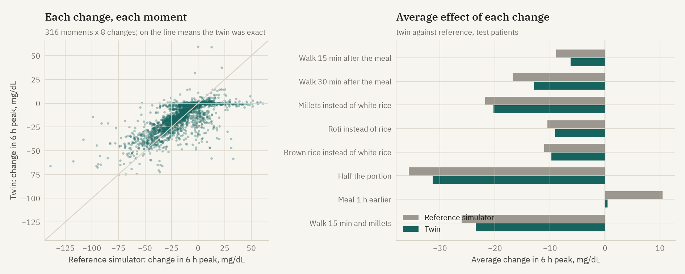

# Are the what if answers right? Checked against the reference simulator

Synthetic data only. The synthetic patients come from a richer simulator than the twin (UVA/Padova based, see docs/DATA.md). It is deterministic, so for any patient and moment it can be re-run with one change applied to what the patient actually ate. Nobody can do this with real patients; it is the one thing synthetic data allows that real data does not.

316 moments from 40 test patients, each 40 minutes before a real main meal on days 8 to 29, 8 changes each, 6 hour window. The twin sees only data up to that moment and the patient's declared routine, so its idea of the meal can be off in time and size.

## Overall

* The twin gets the direction right (helps, no change of more than 2 mg/dL, or hurts) **76%** of the time.
* Typical size error: 9.3 mg/dL on the change in peak; correlation 0.73.
* The change that helps most according to the reference is the twin's first choice 69% of the time and in its top two 85% of the time; median rank correlation 0.90.

## By change

| Change | Twin, average change in peak | Reference | Direction agrees | Typical error | Twin, time above 180 | Reference |
|---|---:|---:|---:|---:|---:|---:|
| Walk 15 min after the meal | -6 mg/dL | -9 mg/dL | 71% | 6 mg/dL | -6 min | -8 min |
| Walk 30 min after the meal | -13 mg/dL | -17 mg/dL | 83% | 11 mg/dL | -15 min | -17 min |
| Millets instead of white rice | -20 mg/dL | -22 mg/dL | 83% | 11 mg/dL | -18 min | -20 min |
| Roti instead of rice | -9 mg/dL | -10 mg/dL | 85% | 4 mg/dL | -8 min | -10 min |
| Brown rice instead of white rice | -10 mg/dL | -11 mg/dL | 84% | 5 mg/dL | -7 min | -10 min |
| Half the portion | -31 mg/dL | -36 mg/dL | 91% | 11 mg/dL | -31 min | -35 min |
| Meal 1 h earlier | +0 mg/dL | +10 mg/dL | 31% | 13 mg/dL | +2 min | +4 min |
| Walk 15 min and millets | -23 mg/dL | -26 mg/dL | 83% | 14 mg/dL | -26 min | -27 min |

## What this does and does not show

* It tests the twin's structure (meal absorption, insulin action, exercise) against a different and richer model of the same physiology. Where both models share an assumption (for example how much a 15 minute walk raises glucose uptake) agreement is easier than it would be against real people.
* Sleep, a missed dose and a night shift are not checked here: in the reference simulator they act through day level factors that cannot be changed for one evening without changing the whole day.
* Real patients add behaviour the reference does not have (stress, illness, unlogged snacks). This is a necessary check, not a sufficient one.
