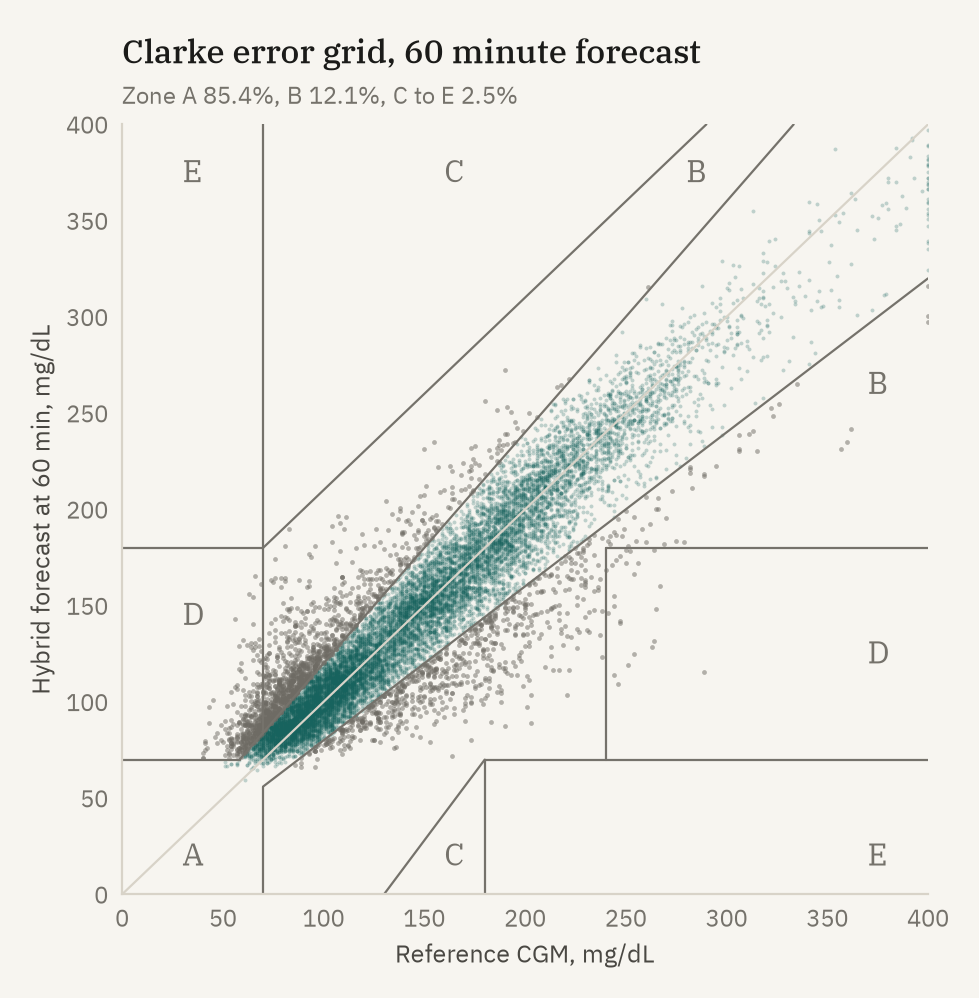
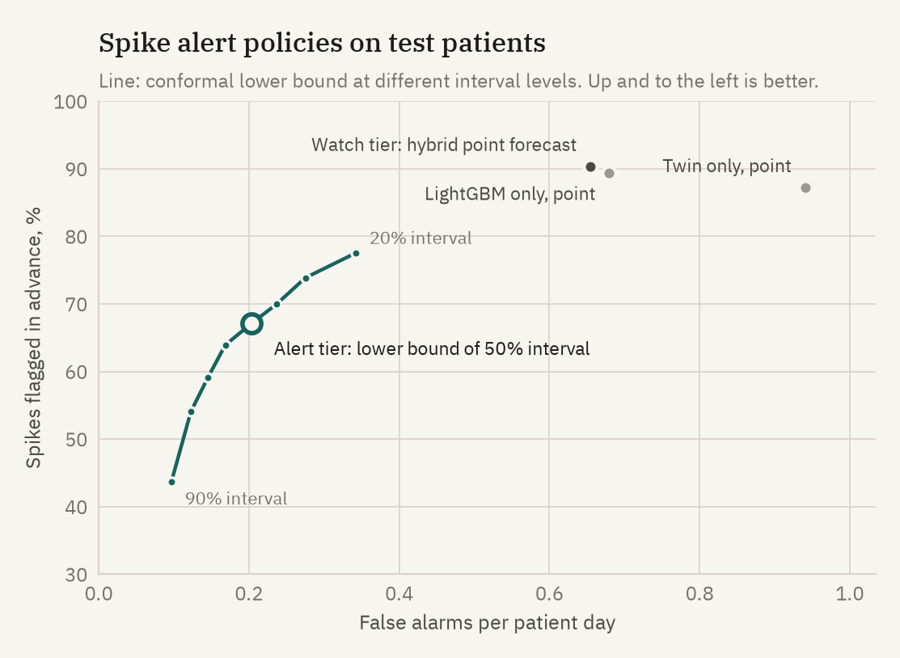
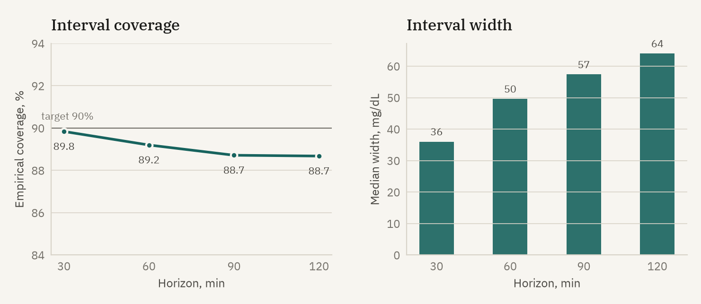
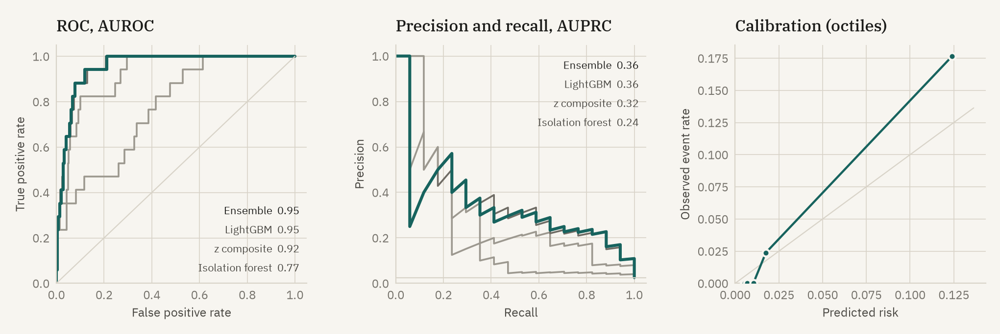
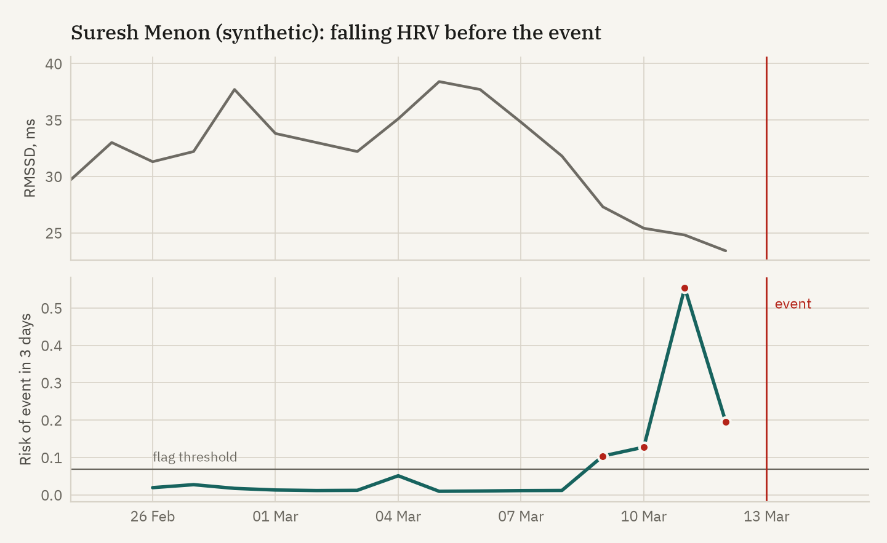

# Prativimb: evaluation report

Generated 19 Oct 2026 from seed 20260315. Synthetic data only. All figures are on **40 test patients** who were not used for training, early stopping or conformal calibration, on days 8 to 30 (days 1 to 7 calibrate each twin).

## 1. Glucose forecasting (Event A)

### Accuracy and ablation

| Model | RMSE 30 min | RMSE 60 min | RMSE 120 min | MARD 30 min | MARD 60 min | MARD 120 min |
|---|---:|---:|---:|---:|---:|---:|
| Twin, EHR prior only | 25.8 | 33.4 | 35.2 | 12.3% | 16.1% | 17.0% |
| Twin, calibrated (physics only) | 16.7 | 24.8 | 29.0 | 9.3% | 13.4% | 16.4% |
| LightGBM only | 13.7 | 21.6 | 27.6 | 7.6% | 11.5% | 14.6% |
| **Hybrid (twin + residual LightGBM)** | **12.9** | **20.2** | **25.2** | **7.4%** | **11.1%** | **13.7%** |

RMSE in mg/dL against the CGM reading at the target time. n = 127,096 forecasts at 60 min.

### Clarke error grid (hybrid)

| Horizon | Zone A | Zone B | Zone C | Zone D | Zone E |
|---|---:|---:|---:|---:|---:|
| 30 min | 94.2% | 4.4% | 0.0% | 1.4% | 0.0% |
| 60 min | 85.4% | 12.1% | 0.0% | 2.5% | 0.0% |
| 120 min | 79.3% | 17.7% | 0.1% | 3.0% | 0.0% |

### Spike alerts (glucose above 180 mg/dL)

A spike is three consecutive CGM readings above 180 mg/dL after at least 30 minutes not above. An alert counts as a detection if it fires up to 2 hours before onset. An alert episode is a false alarm if no spike starts within 2 h 15 min.

Two tiers are deployed. **Watch**: the hybrid point forecast crosses 180 within 2 h; shown on the patient view as an early heads up. **Alert**: the conformal lower bound crosses 180 within 2 h; pushed to the ward list. The alert uses the lower bound of the 50% interval, which reads as at least a 75% chance of exceeding 180. That level was chosen on calibration patients as the most sensitive one with at most 0.10 false alarms per patient day there.

| Policy | Spikes | Sensitivity | Precision | Median lead time | False alarms per patient day |
|---|---:|---:|---:|---:|---:|
| **Alert tier: lower bound of 50% interval (deployed)** | 1599 | 67.1% | 85.2% | 30 min | 0.20 |
| **Watch tier: hybrid point forecast (deployed)** | 1599 | 90.3% | 69.8% | 75 min | 0.65 |
| Lower bound of 90% interval | 1599 | 43.7% | 88.8% | 25 min | 0.10 |
| LightGBM only, point forecast | 1599 | 89.4% | 68.7% | 70 min | 0.68 |
| Twin only, point forecast | 1599 | 87.2% | 56.9% | 105 min | 0.94 |

The lower bound tier trades lead time for precision: at 2 hours the interval is wide, so a confident call usually comes 25 to 35 minutes before onset. The watch tier gives the longer warning with more false alarms, which is why it is not pushed.

Low glucose (secondary): 732 episodes below 70 mg/dL in test patients; point forecast below 70 within 2 h flagged 22% in advance (median lead 40 min, 0.09 false alarms per patient day). Most lows in this cohort are brief dips in people without diabetes and overnight sensor compression artefacts, which a meal driven model cannot anticipate. Low forecasting is a secondary output, not a validated feature.

### Conformal prediction intervals (90% target)

| Horizon | CQR coverage | CQR median width | Plain split coverage | Plain split width | Coverage below 70 | 70 to 180 | above 180 |
|---|---:|---:|---:|---:|---:|---:|---:|
| 30 min | 89.8% | 36 mg/dL | 89.9% | 39 mg/dL | 73% (n=4087) | 91.5% | 87.2% |
| 60 min | 89.2% | 50 mg/dL | 89.4% | 60 mg/dL | 64% (n=4036) | 91.9% | 84.3% |
| 90 min | 88.7% | 57 mg/dL | 89.2% | 71 mg/dL | 60% (n=4019) | 92.0% | 82.7% |
| 120 min | 88.7% | 64 mg/dL | 88.8% | 76 mg/dL | 59% (n=4025) | 92.1% | 82.3% |

Conformalised quantile regression (Romano et al. 2019) gives intervals that widen when the situation is uncertain (for example around unlogged meals) and narrow overnight. At the same marginal coverage they are 8 to 16 percent narrower (median) than a fixed width split interval. Coverage falls in the hypoglycaemic range, where training data are sparse.

## 2. Cardiovascular risk flag (Event B)

Windows: 675 seven day windows from test patients, 17 labelled positive (event in the next 3 days, 6 distinct events). Prevalence 2.5%. 95% intervals are patient level bootstrap (1,000 resamples).

| Detector | AUROC | AUPRC | Sensitivity at 90% specificity | Sensitivity at 95% specificity |
|---|---:|---:|---:|---:|
| Isolation forest (unsupervised) | 0.769 (0.65 to 0.92) | 0.243 (0.02 to 0.58) | 41% | 35% |
| Baseline z score composite | 0.919 (0.87 to 0.98) | 0.315 (0.07 to 0.59) | 76% | 41% |
| LightGBM (supervised) | 0.953 (0.90 to 0.99) | 0.356 (0.11 to 0.65) | 88% | 65% |
| **Stacked ensemble** | 0.954 (0.90 to 0.99) | 0.358 (0.11 to 0.65) | 88% | 65% |

Operating point (threshold set at 95% specificity on calibration patients): test specificity 94.4%, 5 of 6 events flagged in the 3 days before, median lead 3 days, 7.3% of patient days flagged. Brier score 0.020.

## 3. Twin calibration

Median in sample error over the calibration week fell from 28.3 mg/dL (EHR prior only) to 19.9 mg/dL after wearable calibration, across 200 patients. Calibration takes about one second per patient.

## 4. Evaluation design

* Patient level split: 120 train, 40 calibration, 40 test. No patient contributes to more than one split. The three demo patients are in the test split.
* Twin parameters use only days 1 to 7 of each patient; every forecast is scored on days 8 to 30.
* Forecasts use only information available at the origin. Future meals come from the routine the patient declared at enrolment, not from the meal log.
* Early stopping uses a validation slice of training patients.

## 5. Limitations

* All data are synthetic. The ground truth simulator (UVA/Padova based) is more complex than the twin, but it is still a model; real patients have behaviours and sensor artefacts we did not simulate. These numbers show the method works end to end; they are not evidence of clinical performance.
* Cardiovascular events are a synthetic composite driven by a latent strain process. With 6 events among test patients the confidence intervals are wide, and the supervised model has learned the shape of our simulated prodrome. Prospective validation on real outcomes would be required.
* Conformal coverage assumes exchangeability. Readings within a patient are serially correlated, so the guarantee is approximate; coverage is lower in the hypoglycaemic range, where data are scarce.
* Spike alerts depend on the declared routine. Unlogged or unplanned meals are the main source of missed spikes and wide intervals.
* The dawn phenomenon amplitude was not identifiable from seven days for most patients and usually fits to zero.
* Decision support only. Nothing here is a diagnosis or a treatment recommendation.
